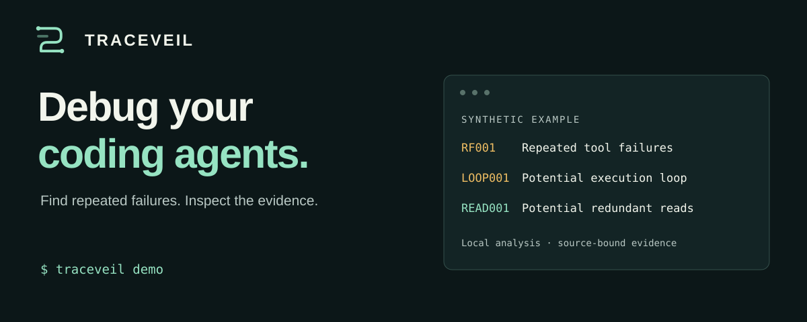

# Traceveil

**Debug your coding agents.**

Traceveil finds repeated tool failures, possible execution loops and potentially redundant reads in local coding-agent sessions. Every finding links to recorded evidence. Use it when an agent keeps retrying, repeats a sequence or rereads the same material.

**0.2.0-rc.1 · Linux prerelease.** The installed binary runs offline. No public npm, crates.io or Homebrew channel is verified for this candidate.

## Try it

Install on Linux/WSL x86_64 with glibc 2.34 or newer:

~~~sh
curl -fsSL https://github.com/zhugez/traceveil/raw/main/install.sh | sh
~~~

The installer downloads the pinned release without sudo or Rust. It verifies the archive SHA256 and preserves shell profiles. See the [public HTTPS installation check](benchmarks/results/public-one-line-installation.json) and [installer regression checks](benchmarks/results/one-line-installation.json).

Add the default installation directory to PATH if needed, then try the demo:

~~~sh
export PATH="$HOME/.local/bin:$PATH"
traceveil demo
traceveil inspect f001 --demo
~~~

The demo is embedded in the executable and runs through the production diagnostic engine. It needs no session files, repository checkout, Python, Node.js or API key at runtime. Its data is synthetic.

For your current Pi project:

~~~sh
traceveil analyze --last
~~~

This authorizes one project-scoped Pi session directory. Traceveil shows partial or skipped coverage when evidence is missing. Run traceveil in a terminal for a small menu. Pipelines receive a short welcome instead of an interactive wizard.

[Install a native archive or build from source](docs/installation.md) · [First real report](docs/getting-started.md) · [Captured demo](docs/examples/demo.txt)

## Read the evidence, then decide

| Rule | Recorded pattern | What it does not prove |
|---|---|---|
| RF001 | Equivalent tool failures recur | Their cause or whether retrying was intentional |
| LOOP001 | A bounded action sequence repeats | That progress was impossible |
| READ001 | Complete matching read ranges recur | That rereading was unnecessary |

A report separates counts, findings, rule coverage and next actions. Inspect recomputes the finding against the same source bytes and policy. Changed sources reject stale references. There is no health score or estimated savings.

[Understand a report](docs/reports.md) · [Rule requirements](docs/diagnostics.md)

## Use your workflow

~~~sh
traceveil sessions --agent pi
traceveil analyze SESSION --agent pi --json
traceveil analyze --stdin --json < events.jsonl
traceveil skills install --agent pi --scope project
traceveil completions bash
~~~

Replace SESSION with an authorized Pi v3 file. Standard input accepts the documented canonical JSONL format, not arbitrary agent logs. Skill installation is optional and preserves modified or unrecognized files by default. The diagnose command retains the original explicit-source interface and defaults.

[Pi discovery](docs/pi.md) · [Configuration](docs/configuration.md) · [Agent Skill](skills/traceveil/SKILL.md) · [CLI contracts](docs/usage.md)

## Local by default

Analysis reads selected source files without changing them. Reports omit raw prompts, arguments and outputs. Discovery can expose private file paths. Fingerprints are not anonymization. Only explicit configuration and skill commands write local setup files.

One Rust executable. No runtime cloud, model, database, daemon, mandatory MCP server or telemetry. Read [SECURITY.md](SECURITY.md) and the [privacy model](docs/security/privacy-model.md) before sharing results.

## What is supported

- **Adapters:** Pi session v3, selected recorded lineage; canonical JSONL 1.0. Nested Code Mode activity remains partial.
- **Runtime acceptance:** Linux x86_64, WSL2/glibc. Windows x86_64 and macOS ARM code compile checks pass; native runtime and installer validation remain release gates.
- **Other agents:** Claude Code, Codex and OpenCode adapters are not implemented. Detecting a directory is not adapter support.
- **Distribution:** published Linux native prerelease, source Cargo installation and a private local npm tarball. Public npm, crates.io and Homebrew channels remain unavailable.

Synthetic labels establish regression behavior, not field accuracy. Earlier authorized real-Pi validation established correlation and coverage behavior. It did not establish positive field effectiveness. See [validation](docs/benchmarks.md), [core candidate evidence](benchmarks/results/productization.json) and [release gates](docs/releasing.md).

## Contribute

[Architecture](docs/architecture.md) · [Contributor checks](CONTRIBUTING.md) · [Changelog](CHANGELOG.md) · [Brand assets](assets/brand/README.md)

Traceveil retains the [GNU GPL version 3](LICENSE).
